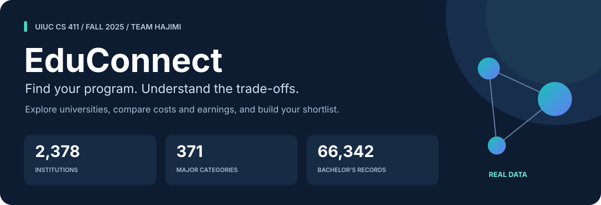
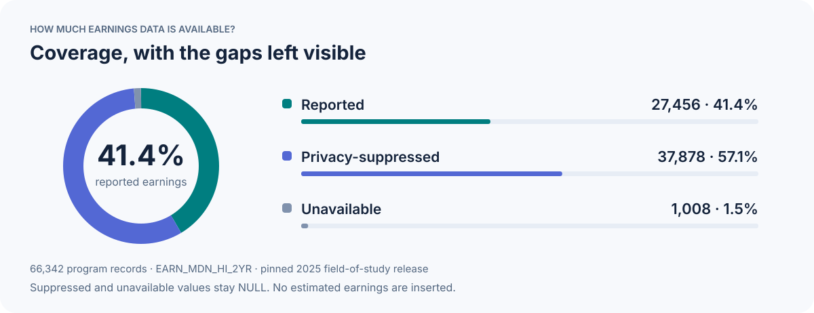
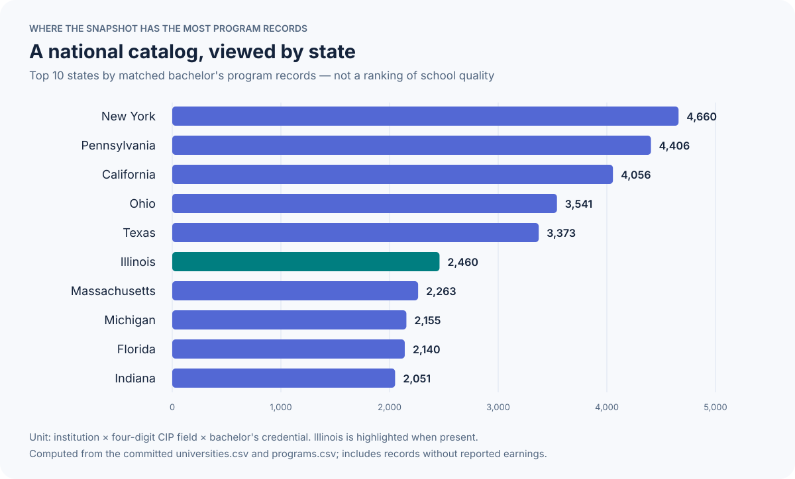
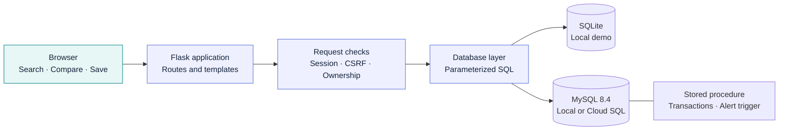
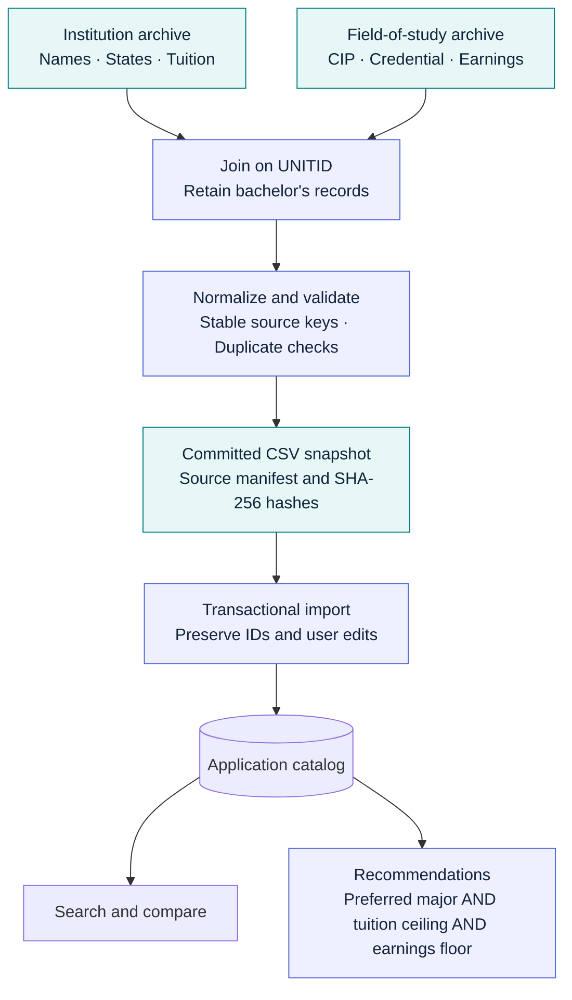
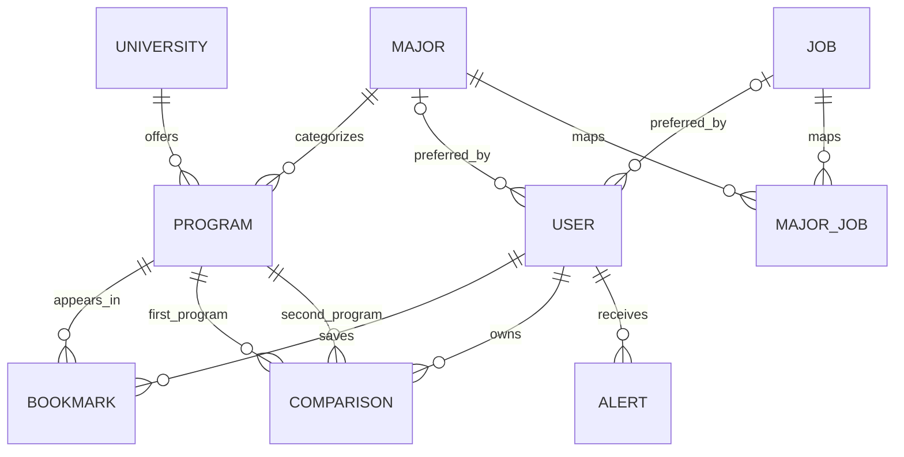

<p align="center">
  
</p>

<p align="center">
  <a href="https://github.com/WHZ2003/CS-411/actions/workflows/ci.yml"></a>
  
  
  
  
</p>

<p align="center">
  <a href="#quick-start">Quick start</a> ·
  <a href="#inside-the-dataset">Dataset</a> ·
  <a href="#how-it-works">Architecture</a> ·
  <a href="#database-design">Database design</a> ·
  <a href="#disclaimer">Disclaimer</a>
</p>

# College decisions, backed by data

**EduConnect** helps students explore universities and undergraduate programs,
compare tuition with reported graduate earnings, and build a personal shortlist.
Built for **UIUC CS 411 · Fall 2025 · Team 050 Hajimi**, it puts relational database
concepts behind a working student-facing application.

**Run locally with SQLite or use MySQL and GCP Cloud SQL.** The committed
[College Scorecard](https://catalog.data.gov/dataset/college-scorecard) snapshot
makes the first run independent of API keys and data downloads. Joins, transactions,
a recommendation stored procedure, and an alert trigger preserve the database
engineering focus of the original project.

> **Snapshot, not a live feed.** The included catalog uses pinned 2025 releases.
> Missing earnings remain missing, and every imported program retains its source.

## Explore → compare → shortlist

| Discover | Decide | Keep track |
| :--- | :--- | :--- |
| Search by university, major, keyword, or state | Compare annual in-state and out-of-state tuition | Save private bookmarks and comparison notes |
| Filter by tuition and reported earnings | See source labels alongside financial data | Set a preferred major for recommendations |
| Browse real institution/field/credential records | Apply a tuition ceiling and earnings floor | Receive an alert for reported earnings below $60,000 |

Under the hood: **session authentication · password hashing · CSRF protection ·
account ownership checks · administrator-only catalog edits**.

## Quick start

Requires **Python 3.12+**. SQLite is the default; MySQL setup is below.

```powershell
git clone https://github.com/WHZ2003/CS-411.git
cd CS-411
python -m venv .venv
.\.venv\Scripts\Activate.ps1
python -m pip install -r requirements.txt
python -m flask --app main init-db
python -m flask --app main import-scorecard
python -m flask --app main create-user --username yourname
python main.py
```

On macOS/Linux, activate with `source .venv/bin/activate` instead. If PowerShell
blocks activation, use `.\.venv\Scripts\python.exe` in place of `python`.

Open **http://127.0.0.1:5001/login**. `create-user` prompts for a password of at
least 12 characters; no shared or hardcoded credentials are shipped. Add `--admin`
when creating an administrator. After login, select **User Info → Edit Preferences**
and choose a major before trying recommendations.

Try a keyword search for `Illinois Urbana` or a major search for `Computer Science`
with state `IL`. Search displays up to 200 rows; refine the query to narrow results.

## Inside the dataset

The catalog spans **2,378 institutions**, **371 four-digit CIP categories**, and
**66,342 bachelor's program records**. Each program record represents an
institution–field–credential combination, rather than an individual course.



Only **41.4%** of included records report the selected earnings metric. Records
without earnings remain searchable, but cannot satisfy an earnings filter.



The bars measure **catalog coverage**, not enrollment, school quality, or outcomes.
Counts include records with and without reported earnings. Both charts are generated
from the committed snapshot using [`scripts/render_readme_assets.py`](scripts/render_readme_assets.py).

<details>
<summary><strong>Read the field definitions and data limitations</strong></summary>


| Application field | Source | Meaning |
| --- | --- | --- |
| Institution | `UNITID`, `INSTNM`, `STABBR` | Official institution identifier, name, and state |
| Major | `CIPCODE`, `CIPDESC` | Four-digit field-of-study category; not a university's exact degree title |
| Program | `UNITID` + `CIPCODE` + `CREDLEV` | Institution/field/credential combination; bachelor's only (`CREDLEV=3`) |
| Tuition | `TUITIONFEE_IN` | Annual institution-level undergraduate in-state tuition and fees |
| Out-of-state tuition | `TUITIONFEE_OUT` | Retained separately and shown in comparisons |
| Median earnings | `EARN_MDN_HI_2YR` | Median earnings two years after completion for the source's covered population |

Earnings describe federally aided, working, non-enrolled graduates covered by the
source, not all graduates, job offers, or guaranteed salaries. **27,456** program
records report earnings; **38,886** have suppressed or unavailable earnings, which
remain SQL `NULL` and display as **Not reported**. Filters that require earnings
exclude those rows. Tuition is neither net price nor total degree cost.

`MedianSalary` remains the internal column/API name for compatibility with the
course project, but the UI labels the measure as earnings. The average-by-major
endpoint is an **unweighted average of reported program medians**, not the median
earnings of all students in that major.

The school and field-of-study releases pool different measurement years. Their
release dates do not imply that every metric measures 2025. See
[data provenance and reproducibility](docs/DATA.md) for URLs, hashes, exclusions,
coverage, and the optional official API.

College Scorecard does **not** contain company job postings or a validated
major-to-job mapping. `Job` and `MajorJob` are retained but empty. The related
course transaction is tested using isolated fixtures and requires a separately
sourced job dataset before use. User accounts and interactions are created by
users; they are not imported student records.

</details>

## How it works

The same Flask application supports a lightweight local setup and the original
MySQL deployment path. Schema changes and imports run through CLI commands.



### From official downloads to useful comparisons



**No hidden fallback:** if no programs satisfy the recommendation constraints,
the result is empty. The app never silently substitutes another major or a higher budget.

## Database design

The catalog and personal shortlist share a relational model with explicit foreign
keys. Bookmarks are unique per user/program pair; comparisons reference two
distinct programs. The job tables are a retained extension and are empty in the
bundled snapshot.



| Database concept | Where it appears |
| :--- | :--- |
| Multi-table joins | Program search, details, bookmarks, and comparisons |
| Stored procedure | MySQL `RecommendProgramsForUser`; equivalent SQLite query |
| Transactions | Catalog imports and major–job relationship updates |
| Trigger | Bookmarking a program with reported earnings below $60,000 creates an alert |
| Integrity constraints | Foreign keys, unique source keys, and duplicate bookmark prevention |

See [architecture notes](docs/ARCHITECTURE.md) and the [SQL definitions](sql/) for details.

## Refresh or reproduce the snapshot

```powershell
python scripts/prepare_scorecard.py --download
python -m flask --app main import-scorecard
python scripts/render_readme_assets.py
```

This redownloads the **same pinned releases**, normalizes them, and records archive
and output SHA-256 hashes. Without `--download`, cached archives under `data/raw/`
are reused. To adopt a newer release, deliberately update the source URLs and
metric mapping, then rerun tests; upstream schemas and cohort meanings may change.

The import is transactional and repeatable. Program IDs remain stable across
reimports, preserving bookmarks. User-edited programs are not overwritten, and
records absent from a later input are not automatically deleted. See `docs/DATA.md`
for the refresh boundary.

## MySQL and GCP

Create an **empty MySQL 8.4 database** and a database user with permission to create
tables, indexes, triggers, and procedures. Copy `.env.example` to `.env`, set
`DATABASE_BACKEND=mysql`, and configure `DB_HOST`, `DB_PORT`, `DB_USER`,
`DB_PASSWORD`, and `DB_NAME`. Then run the same `init-db`, `import-scorecard`, and
`create-user` commands.

MySQL uses `sql/recommend.mysql.sql` and `sql/trigger.mysql.sql`; SQLite provides
equivalent local behavior. The old database is not contacted or modified.
`init-db` creates missing objects; it is **not a migration for an existing legacy
schema**. Back up any old database and use a fresh schema for this restoration.

See [deployment notes](docs/DEPLOYMENT.md) and `deploy/app.yaml.example` for App Engine
and Cloud SQL configuration. No cloud deployment or paid resources are created
by this repository. Original embedded database credentials have been removed.

## Tests

```powershell
python -m pip install -r requirements-dev.txt
python -m pytest -q
ruff check .
ruff format --check .
node --check static/app.js
```

GitHub Actions tests SQLite and MySQL 8.4, including real-snapshot imports,
idempotency, rollback, privacy-suppressed values, strict recommendations, ownership,
CSRF, password hashing, admin CRUD, the alert trigger, and the major–job transaction.
Node.js is only needed for the JavaScript syntax check, not for serving the app.

## Repository layout

```text
educonnect/         App factory, routes, database layer, CLI commands
main.py             Flask / WSGI entry point
templates/          Original project pages, corrected and annotated
static/             Frontend JavaScript and styles
sql/                SQLite and MySQL schema, triggers, recommendation procedure
scripts/            Data normalization and README chart generation
data/processed/     Real normalized snapshot and provenance manifest
tests/              Isolated API, transaction, importer, and data tests
docs/               Architecture, data, deployment, and course history
docs/assets/        Generated SVG banner and dataset charts
deploy/             Credential-free GCP configuration example
```

## Credits and restoration

Original authors: **Wenhao Zhang, Yuhui Liu, Tianxiang Wu, and Zixuan Huang**.
Original course metadata and revision notes are under `docs/course/`; these are
historical descriptions, not claims about current data coverage or deployment.
The original local project archive and binary course submissions were preserved
in their original location and were not rewritten. No code license was inferred
for the team's work. Dataset attribution is documented separately.

See [restoration changes](docs/CHANGES.md) for fixes and remaining boundaries.

## Disclaimer

EduConnect is a student-built educational and research project. It is not an
official university admissions service and is not endorsed by the University of
Illinois Urbana-Champaign, the U.S. Department of Education, or any institution
listed in the dataset.

The application and data are provided **as is**, without warranties of accuracy,
completeness, timeliness, or fitness for a particular purpose. Published figures
may be historical, incomplete, suppressed, or based on limited populations.
Reported earnings do not guarantee an individual's salary, employment, admission,
or return on educational spending. Recommendations reflect the selected filters;
they are not personalized admissions, career, or financial advice.

Verify tuition, program availability, admissions requirements, and other material
details directly with the relevant institutions and official sources before
making decisions. To the extent permitted by applicable law, the contributors
disclaim liability for losses arising from use of this application or its data.
