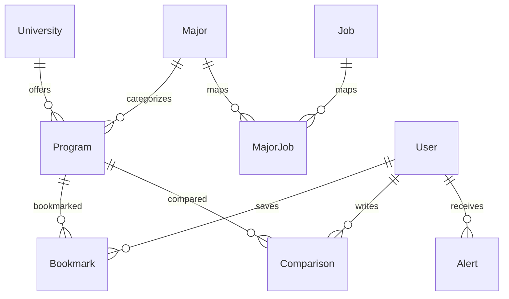

# Architecture

Browser → Flask routes → parameterized relational SQL → SQLite (local) or MySQL
(Cloud SQL). HTML and JavaScript keep the original course interface and endpoint
shape. The application factory centralizes sessions, authorization, CSRF, error
handling, and connection cleanup.

- `UniversityID`: College Scorecard `UNITID`.
- `Major.CIPCode`: original four-digit CIP code, with leading zeros.
- `Program.SourceKey`: unique institution/field/credential key used by imports.
- `User`: application accounts, unrelated to federally reported student records.
- `Bookmark`: composite primary key prevents duplicate bookmarks.
- `Comparison`: two distinct program foreign keys and user-owned notes.
- `Alert`: generated by a database trigger; global auto-increment ID avoids races.
- `Job` / `MajorJob`: retained course extension tables, empty in the real snapshot.

MySQL recommendations call `RecommendProgramsForUser`; SQLite uses an equivalent
parameterized query. Both return at most 200 matching programs, ordered by
earnings then ID. The major–job update uses a serializable MySQL transaction
(SQLite `BEGIN IMMEDIATE`) and rolls back on failure.

API queries use bound parameters. SQLite's small DB-API adapter translates only
the placeholder syntax; dialect-specific DDL, triggers, and upserts are explicit.
Request teardown rolls back abandoned transactions and closes connections.

The official-data normalizer uses only Python's standard library. Source and
normalized file hashes live in the manifest, independent of the runtime database.
